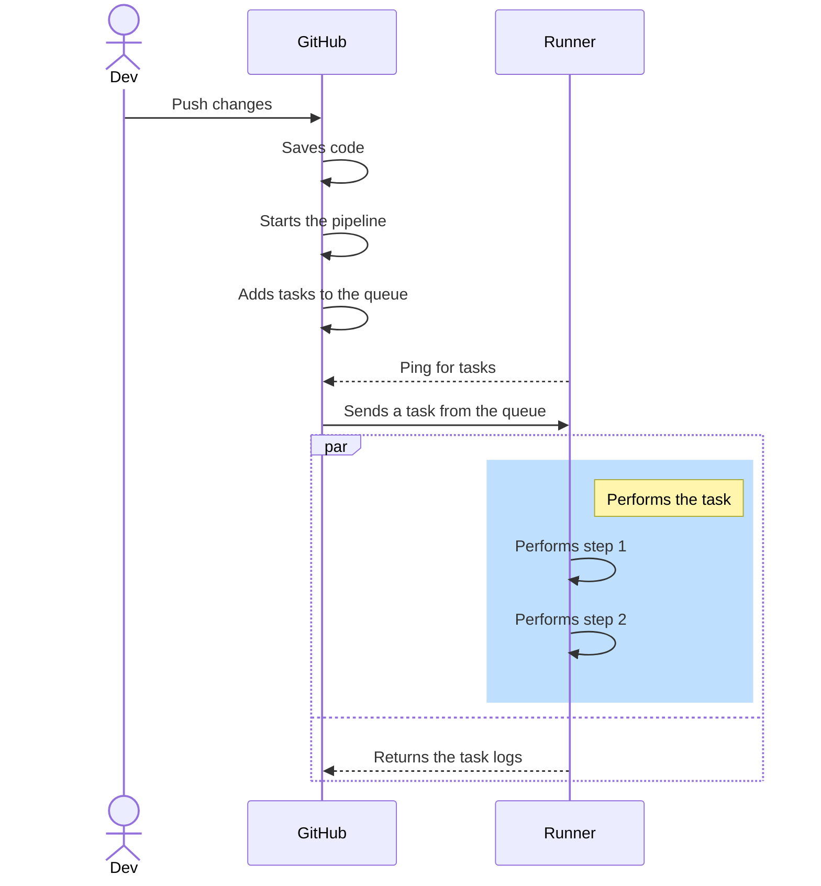
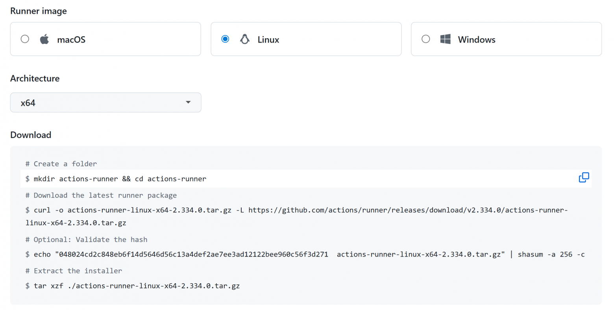
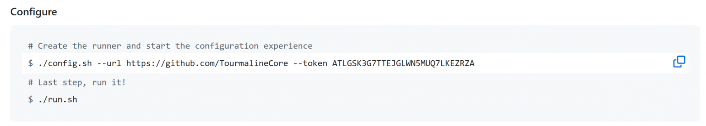
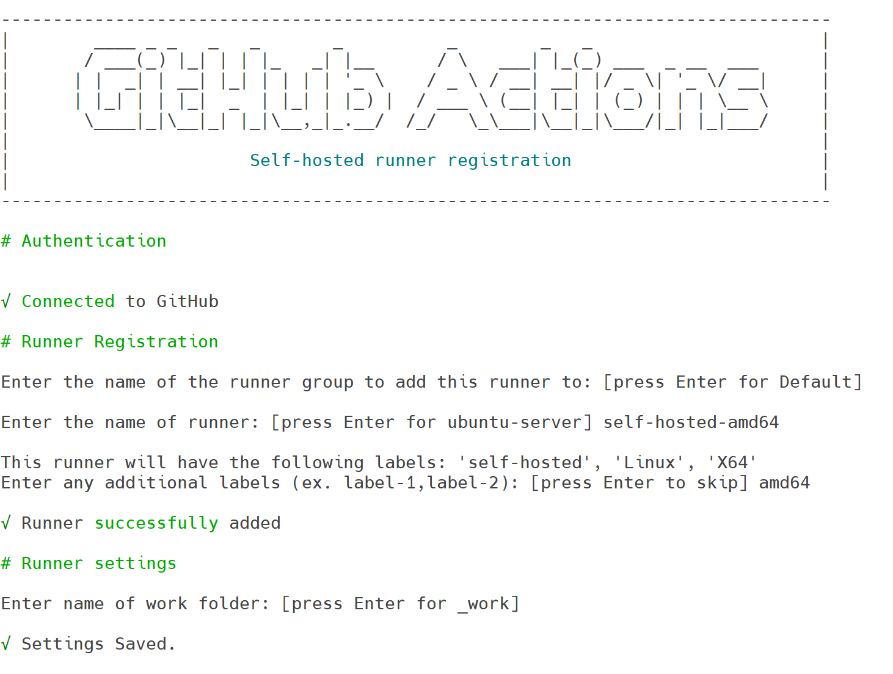
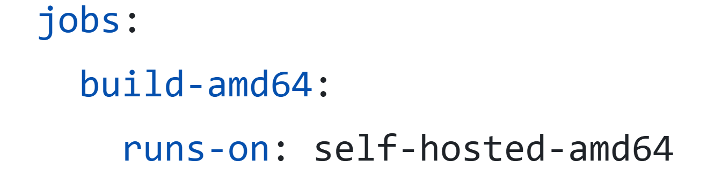
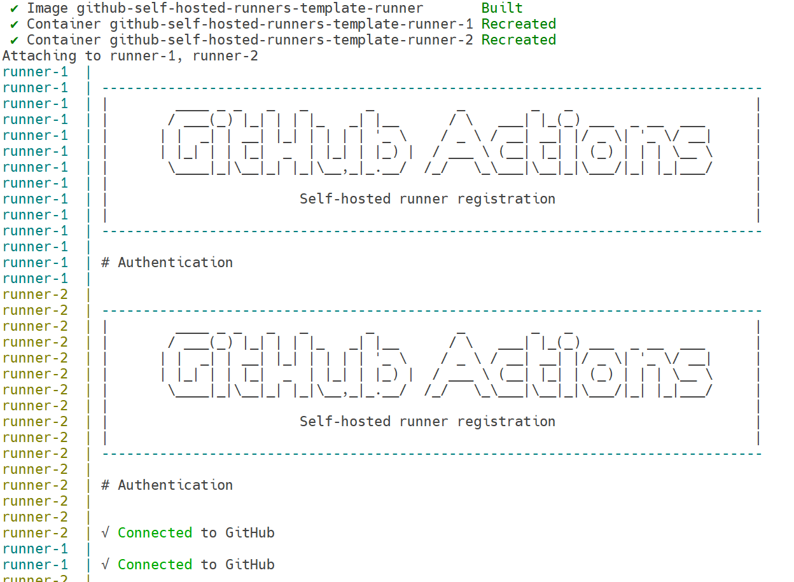

# GitHub self-hosted runner in Docker: how to set up multiple isolated runners on a single host. Part 1

If you have private repositories on GitHub and a team that regularly hits the GitHub Actions time limit, this article will save you a couple of weeks of experimentation.

We’ll explain what runners are, how to set up self-hosted runners on Bare Metal and inside containers, how to configure their replication using Docker Compose, as well as the challenges we faced while searching for solutions to our problems, and what Docker-in-Docker has to do with it. We've tried to explain everything in enough detail that even beginners can follow along.

If you'd like to see the result right away, you can find the complete source code and running instructions [here](https://github.com/TourmalineCore/github-self-hosted-runners-template).

## Article navigation
* [Background and description of the problem](#background-and-description-of-the-problem)
* [Basics: Who are runners, and where do they run?](#basics-who-are-runners-and-where-do-they-run)
  + [About multiplatform](#about-multiplatform)
  + [Our setup](#our-setup)
  + [Deploying a self-hosted Bare Metal runner](#deploying-a-self-hosted-bare-metal-runner)
* [Evolving from Bare Metal to a container](#evolving-from-bare-metal-to-a-container)
  + [Testing the Bare Metal runner](#testing-the-bare-metal-runner)
  + [Running runners in Docker](#running-runners-in-docker)
      - [Environment variables](#environment-variables)
      - [Building an image](#building-an-image)
      - [Setting up a configuration for Docker Compose](#setting-up-a-configuration-for-docker-compose)
      - [Script for running the runner](#script-for-running-the-runner)
  + [New challenges](#new-challenges)
  + [Building a DinD Runner](#building-a-dind-runner)
      - [Building an image](#building-an-image-1)
      - [Script for running the runner](#script-for-running-the-runner-1)
      - [Docker Compose configuration](#docker-compose-configuration)
  + [Results](#results)

## Background and description of the problem

We used to use GitHub for open-source projects and GitLab for private development. But at one point, we were unable to register new GitLab accounts using Russian phone numbers, which tipped the scales in GitHub’s favor for private development too.

A team of three people was working on a private project on GitHub. Every day, the team actively committed changes, and after each push to the branch, pipelines were triggered. Their total execution time was about 50 minutes. GitHub allocates [2,000 minutes](https://docs.github.com/en/get-started/learning-about-github/githubs-plans#github-free-for-organizations) per month to each organization for running pipelines on its runners for private repositories. The team used up these minutes during the first workweek of the month. Once the allocated minutes ran out, we had to wait until the next month to use GitHub Runners again. Because the minutes ran out, the process of deploying features to production stopped for all teams in the GitHub organization (they share a common limit across all of the organization’s repositories), so this limitation became a serious problem.

At the time when we were using GitLab for private development, we used self-managed GitLab runners, which allowed us to run all our pipelines on our servers at the office. GitHub has a similar tool called GitHub [self-hosted runners](https://docs.github.com/en/actions/concepts/runners/self-hosted-runners), and it helped solve all our problems.

In addition to our issue with minute limits, here are some other examples of problems that self-hosted GitHub runners can help you with:

* You have a device that you need to use in pipelines. For example, a graphics card that's connected to a server in your office, rather than in the GitHub data center.
* You have a private resource that should only be accessible from a specific IP address, and this resource is used in pipelines. For example, a remote server that can only be accessed from your office.
* The CPU and RAM resources allocated by GitHub may not be sufficient for your needs. For private repositories, the limit is 2 CPUs and 8 GB of RAM. Learn more [here](https://docs.github.com/en/actions/reference/runners/github-hosted-runners#standard-github-hosted-runners-for--private-repositories).

## Basics: Who are runners, and where do they run?

Have you ever wondered how your pipelines start up after you push a new commit? Beginner engineers may be overcome by fear when they hear about some kind of runners. It takes you a moment to realize what kind of runners they are. There's really nothing scary about them. A runner is a Bare Metal server or virtual machine to which your CI/CD pipeline code is downloaded and executed, described in .yaml files in the folder `.github`.



GitHub initially provides its own runners where many [tools](https://github.com/actions/runner-images/blob/main/images/ubuntu/Ubuntu2404-Readme.md) are pre-installed for your convenience. But there are many situations in which you may need a second type of runner, self-hosted. Self-hosted runners are the same runners that can run pipelines, but now they will run on your servers, use your server resources and store data on your servers while pipelines are running rather than on GitHub's servers. You can pre-install any tools, connect any devices needed for your project, and choose your own hardware configuration.

### About multiplatform
In our company, everyone works on different devices, and these devices, in turn, run on different architectures: amd64 and arm64. Therefore, it is important for us to build Docker images for both amd64 and arm64, which means that we need to have 2 servers on the appropriate architectures. Experienced engineers might note that you can use the QEMU emulator to build an image for 2 platforms at once, using only 1 device. However, when using QEMU, the build time of images increases significantly, and in our comparison, it turns out to be much faster to build on native runners. You can find more details about the comparison in the presentation recording at the [link with the timecode](https://youtu.be/Xn8qtCbTffM?si=Xle8xI8XEX_igP4i&t=560).

But in short, the measurements are as follows:

<table>
    <thead>
        <tr>
            <th>Service</th>
            <th>Result with QEMU</th>
            <th>Result with native runners</th>
        </tr>
    </thead>
    <tbody>
        <tr>
            <td valign="top">Strapi CMS</td>
            <td valign="top">18 minutes</td>
            <td valign="top">4 minutes</td>
        </tr>
        <tr>
            <td valign="top">NextJS UI</td>
            <td valign="top">13 minutes</td>
            <td valign="top">2 minutes</td>
        </tr>
    </tbody>
</table>

We had a PC in our office that was suitable for native build, so we decided to use it for this job.

### Our setup
For the amd64 build, we used a server with a Ryzen Threadripper PRO 3975W processor and Ubuntu Server 24.04 OS.
There is less choice for the arm64 build, and we chose our existing Mac Mini with an Apple M2 processor and macOS Tahoe OS.

<p align="center">
  
</p>

### Deploying a self-hosted Bare Metal runner
GitHub provides [instructions](https://docs.github.com/en/actions/how-tos/manage-runners/self-hosted-runners/add-runners) on how to deploy self-hosted runners.
It turned out that you don't need to perform many actions to create a runner, and everything can be set up with just a few commands. To do this, select the OS, architecture, and execute commands to download the runner.
<p align="center">
  
</p>

Next, we link the runner to the organization and launch it.
<p align="center">
  
</p>

When launching the runner through an interactive dialog, you can specify:
* A separate group for the runner. Runners are grouped in order to control which repositories and pipelines can interact with runners from this group.
* A name, so you can easily find it in the list of runners. It can be convenient when you want to separate runners by hardware configuration. For example, you can come up with a naming convention and name the runner «self-hosted-amd64-4cpu-8ram», which will mean amd64 architecture, 4 processor cores and 8 GB of RAM.
* Labels that allow you to target specific runners when executing pipelines. For example, you can separate runners by hardware configuration.:
```yaml
jobs:   
  build-amd64:  
    runs-on: [self-hosted, 4gb, 4cpu, amd64] # runner with 4 GB of RAM, 4 CPU cores, amd64 architecture
  build-arm64:  
    runs-on: [self-hosted, gpu, arm64] # runner that has a graphics card and an arm64 architecture
```
But we'll leave the default runner group, because for the purposes of this article we don't need to manage access to the runner, and we'll also change the name and label to distinguish the runners from each other and use the amd64 runner to build the amd64 image.
<p align="center">
  
</p>
For the arm64 runner, everything is done the same way.

>**Note**: All of our pipelines are written for Ubuntu. For example, we use the following command:
>
>`echo "REGISTRY_IMAGE=ghcr.io/${GITHUB_REPOSITORY,,}" >>${GITHUB_ENV}`
>
>This command will not run on macOS and will fail with a «bad substitution» error. If a runner on macOS attempts to run a pipeline that uses this command, the pipeline will fail. There are two ways to resolve this issue:
>1. Rewrite the pipelines for macOS.
>2. Run the runner as a Docker container using the Ubuntu base image.
>
>We chose the second option and will consider it later.

## Evolving from Bare Metal to a container

### Testing the Bare Metal runner
To run pipelines on self-hosted runners, you need to specify the label of the desired runner in «runs-on». In our case, this is «self-hosted-amd64» for building an amd64 image.
<p align="center">
  
</p>

Let's go to Actions and see the results of our work…
<p align="center">
  
</p>

The installed runners do not include all the tools that come pre-installed on [GitHub-runners](https://github.com/actions/runner-images/blob/main/images/ubuntu/Ubuntu2404-Readme.md), so you need to install all the necessary tools on your machine in advance.
In our case, Docker is missing, so we’ll install it following [these](https://docs.docker.com/engine/install/ubuntu) instructions, grant access to a non-root user following [these](https://docs.docker.com/engine/install/linux-postinstall/#manage-docker-as-a-non-root-user) instruction, and restart the pipeline.
<p align="center">
  
</p>

Great, the build succeeded, but what do you do when you need to run multiple pipelines at the same time but only have one server?

You could try copying the current runner’s directory multiple times and launching several Bare Metal replicas. Let’s imagine a scenario where you need to launch 50 replicas of a single runner. In that case, you’d have to copy the runner to 50 directories and launch each replica manually. But what if there’s a power outage? Then you’d have to manually restart all 50 replicas, which is very inconvenient.
Someone might argue that this could be automated with a script with which you can automate all this, but who wants to go through that… Another drawback we’ve already encountered is having to install all dependencies before running the runner. If we use multiple Bare Metal machines, we’ll have to install all the dependencies every single time. There’s also the ongoing issue that we can’t natively build an arm64 image using a Mac mini, because the image build pipelines are written for Ubuntu. If we want to run the pipelines, we’ll have to rewrite them for macOS.

We’ve come to the conclusion that runners can be run as separate Docker containers, because that way we can specify all the tools in advance in the Dockerfile, easily reproduce the runner, and create multiple replicas of the runner using Docker Compose.

### Running runners in Docker
Unfortunately, GitHub doesn’t offer a ready-made solution for deploying a runner into a container without using Kubernetes (unlike GitLab, for example). While researching this issue online, we found an [implementation](https://github.com/Groupe-3D/self-hosted-runner) that should help us. The current implementation includes many tools that aren’t necessary for our purposes. Let’s build a minimal image based on this repository.

#### Environment variables
The first step is to create a file in which all the variables will be recorded. As usual, we'll call this file `.env`.

*.env*

`REPOSITORY_OWNER` — the organization to which the runner will be added.  
`REG_TOKEN` — the token used to link the runner to the organization. The token is valid for 1 hour; if you need to recreate the container, you’ll need to obtain a new one.  
`RUNNER_GROUP` — the runner group to which the runner will be added.  
`LABELS` — labels that can be used to identify the runner.

```
REPOSITORY_OWNER=TourmalineCore
REG_TOKEN=ATLGSK5MV5ACPPPTKVMEITJ5IHYY  
RUNNER_GROUP=Default  
LABELS=self-hosted-amd64
```

#### Building an image
*DockerImage/Dockerfile*
Now let's move on to building the image itself. First, we specify the base for our image. We use the same distribution that was used to run the pipelines when we were using GitHub-runners.
```Dockerfile
FROM ubuntu:24.04
```
Using `update` we get information on the packages available for installation, through `upgrade` we update already installed packages and through `install` we install the minimum set of tools necessary for downloading, configuring and launching the runner.
```Dockerfile
RUN apt-get update -y && \
    apt-get upgrade -y && \
    apt-get install -y \
                curl \
                sudo \
                ca-certificates
```
curl (Client URL) — a command-line utility and library designed to transfer data between a computer and a server using various network protocols. It is required in the image to download the runner.  
sudo (superuser do) — a utility that allows non-root users to execute commands with administrator privileges. It is used in the image to configure the runner’s startup.  
ca-certificates — a package that contains a set of trusted certificates from certificate authorities. It is required to enable TLS connections. It is used in the image to install Docker.

We need Docker in order to build images, so we’ll install it following the [official instructions](https://docs.docker.com/engine/install/ubuntu). To avoid having to specify the Docker version in multiple places, we’ve included it as an argument. Important: You must specify the same version that is installed on your server, or a compatible one. Docker releases can be found [here](https://docs.docker.com/engine/release-notes).
```Dockerfile
ARG DOCKER_VERSION="28.5.2"

RUN install -m 0755 -d /etc/apt/keyrings && \
    curl -fsSL https://download.docker.com/linux/ubuntu/gpg -o /etc/apt/keyrings/docker.asc && \
    chmod a+r /etc/apt/keyrings/docker.asc && \
    # Add the repository to Apt sources:
    echo \
    "deb [arch=$(dpkg --print-architecture) signed-by=/etc/apt/keyrings/docker.asc] https://download.docker.com/linux/ubuntu \
    $(. /etc/os-release && echo "${UBUNTU_CODENAME:-$VERSION_CODENAME}") stable" | \
      tee /etc/apt/sources.list.d/docker.list > /dev/null && \
    apt-get update && \
    apt install -y --no-install-recommends \
                   containerd.io \
                   docker-buildx-plugin \
                   docker-ce-cli=5:${DOCKER_VERSION}-1~ubuntu.24.04~noble \
                   docker-compose-plugin && \
    rm -rf /var/lib/apt/lists/*
```
By default, the runner will fail with the error «Must not run with sudo» if you run it via `sudo`, so you need to create a separate user. For example, with the name `runner`. Additionally, add the newly created user to the `sudo` group and enable password-free access so that commands can be run via `sudo` as this user — you’ll need this to configure the runner in the startup script later on.

```Dockerfile
RUN useradd -m runner && \
    usermod -aG sudo runner && \
    echo "%sudo   ALL=(ALL:ALL) NOPASSWD:ALL" > /etc/sudoers
```
Next, we’ll use the `TARGETARCH` argument built into Docker, which specifies the platform for which the image is being built. This is needed to automatically select the runner based on our hardware platform. We’ll also include the runner version as an argument. This allows us to specify the version in a single place, in case you need to update the runner. The runner releases can be found [here](https://github.com/actions/runner/releases). After downloading the runner, we install the necessary dependencies. Next, copy the script to run the runner (we'll show it later), and call it.

```Dockerfile
ARG TARGETARCH
ARG RUNNER_VERSION="2.334.0"

# In our case, the use of the TARGETARCH argument is focused on amd64 and arm64. If you need additional architectures, then use case, not if
RUN ARCH=$([ "$TARGETARCH" = "amd64" ] && echo x64 || echo arm64) && \
    cd /home/runner && \
    mkdir actions-runner && \
    cd actions-runner && \
    curl -o actions-runner-linux-${ARCH}-${RUNNER_VERSION}.tar.gz -L https://github.com/actions/runner/releases/download/v${RUNNER_VERSION}/actions-runner-linux-${ARCH}-${RUNNER_VERSION}.tar.gz && \
    tar xzf ./actions-runner-linux-${ARCH}-${RUNNER_VERSION}.tar.gz

# Install the dependencies required to run the runner  
RUN /home/runner/actions-runner/bin/installdependencies.sh

USER runner

# Copy the script and make it executable  
COPY start.sh /start.sh
RUN sudo chmod +x /start.sh

ENTRYPOINT ["/start.sh"]
```

#### Setting up a configuration for Docker Compose

The next step is the configuration for Docker Compose. It describes how many runner replicas there will be, how many resources are available to one replica, and other configuration.

*docker-compose.yml*
Specify the path to the Dockerfile.
```yaml
services:
  runner:
    build:
      dockerfile: Dockerfile
      context: ./DockerImage
```
Next, we specify that the runner should always restart automatically, unless it was manually stopped. This is useful if it crashed or if the server on which the runner is deployed was restarted.
Here, we also specify the file from which the variables will be read. In our case, this is `.env`.
```yaml
    restart: unless-stopped
    env_file: .env
```

To configure the number of replicas, enable the `replicated` mode and specify the number of replicas in `replicas`. To configure how many host machine resources are available to a single runner replica, use `limits` and `reservations`. The `limits` specify the maximum amount of CPU and RAM resources that the resource scheduler will allocate to the runner, while the `reservations` specify the amount of CPU and RAM that the scheduler is guaranteed to allocate to the runner. This is not the amount of resources the container consumes at startup, but rather the amount the scheduler reserves for that container. A conscious and competent choice of reservations and limits is beyond the scope of this article.

```yaml
    deploy:  
      mode: replicated  
      replicas: 2  
      resources:  
       limits:  
        cpus: '2'  
        memory: 2G  
       reservations:  
        cpus: '0.1'  
        memory: 256M
```

Next, in order for Docker to run inside the container, you need to grant access to the Docker installed on the host machine. To do this, we’ll pass a socket into the container, which is used for communication between the Docker client and the Docker daemon.

```yaml
    volumes:
      - /var/run/docker.sock:/var/run/docker.sock
```

And finally, let's move on to the script that will run when the container starts.

#### Script for running the runner

In this script, we link the runner to an organization, configure access to the `docker.sock` file so that the runner can communicate with Docker, handle the removal of the runner from the organization when it is stopped, and, at the very end, start the configured runner.

*DockerImage/start.sh*
Add a runner to the organization.

```bash
#!/bin/bash

cd /home/runner/actions-runner || exit

./config.sh --url https://github.com/${REPOSITORY_OWNER} --token ${REG_TOKEN} --runnergroup $RUNNER_GROUP --labels $LABELS
```

Next, you need to configure access to the `docker.sock` file. As mentioned earlier, we are using two servers: one running Ubuntu 24.04 and one running macOS. In Unix-like systems, every file has an owner and a group of users who can read or modify the file, depending on the settings. Each group has its own identifier that can be used to reference it.  
On a host machine running Ubuntu, the `docker.sock` file belongs to the docker group (the docker group typically has ID 988), but there is no docker group inside the container; if you check the file’s owner, it will belong to the numeric ID of the host group (typically 988). To gain access, you need to create a group with this ID inside the container and add the `runner` user to that group.

Things are a bit different for macOS. Under the hood, Docker for macOS is designed differently than for Linux distributions. A Docker group is not created here, and `docker.sock` belongs to the daemon group, and the socket is already proxied to the container with the root group. The root group already exists in the container, so we immediately add the user to this group.
```bash
# Get the ID of the group that owns the file
export DOCKER_GID=$(stat -c '%g' /var/run/docker.sock)

# Check whether the group already exists 
if getent group "${DOCKER_GID}" >/dev/null; then  
  # Add the user to the existing group
  export DOCKER_GNAME=$(stat -c '%G' /var/run/docker.sock)  
  sudo usermod -aG ${DOCKER_GNAME} runner    
else  
  # # Create the group if it doesn't exist, then add the user to it 
  sudo groupadd -g ${DOCKER_GID} docker  
  sudo usermod -aG docker runner  
fi
```
We're processing the removal of the runner from the organization if the container has been stopped. Important: deleting the runner will work within an hour after the token is created, so if you try to stop the container a month after creation, the runner will remain linked to the organization. But that's okay, because GitHub automatically deletes runners that have been offline for 14 days.

```bash
cleanup() {  
  echo "Removing runner..."  
  ./config.sh remove --token ${REG_TOKEN}  
}

# Calling the cleanup method when the TERM signal is received (when the container is stopped)
trap 'cleanup' TERM 
```

Finally, we start the runner and add a wait until the runner process finishes. We do this because the script runs as the container’s entrypoint, so the container exits once the script finishes running. Since the runner user was added to the group that owns `docker.sock` in this same script, the running runner will not see this change. We start the runner via a new session for the runner user, which will include all the current groups.

```bash
# Launch the runner and add a wait until the runner process is completed. This is done so that after executing the script, the container will continue to live and the runner will work.  
sudo -u runner bash -c ./run.sh & wait $!
```

Start the runner with the command `docker compose up --build` and see that several replicas of the same runner are now running simultaneously. To run it in the background, we add the `-d` flag. We use the `--build` flag to ensure that a new image is always built, rather than using a previously built one.
```bash
docker compose up -d --build 
```

<p align="center">
  
</p>

Use the same command to run the arm64 runner on the appropriate server.

Now you can run the amd64 + arm64 image build in the pipelines and enjoy the results.

>[Here's](https://github.com/TourmalineCore/inner-circle-items-api/blob/master/.github/workflows/.reusable-docker-build-and-push.yml) an example of a pipeline that builds images for amd64 and arm64. This pipeline runs on GitHub Runners because it's a public repository, which means it has an unlimited quota for using runners.

### New challenges
In our pipelines, we not only build Docker images but also run tests. For example, to run high-level E2E tests, we create a k8s cluster and test the services deployed within it. If we run just one such test, everything works fine. But if we run these tests in parallel on multiple runners, we run into the problem that a cluster with the project name already exists, and we can’t create another one.  
Why does this happen?  
The reason is that when we created the runner, we mounted the Docker socket /var/run/docker.sock:/var/run/docker.sock. This approach is called “Docker-outside-of-Docker” and means that all Docker calls within the container are routed outside the container and executed by the Docker installed on the host machine. And if this Docker socket is mounted in every runner, then all runners effectively share a single Docker instance and a set of shared containers. At first glance, the solution seemed simple. You need to run Docker inside the runner instead of mounting the Docker socket. This approach is called Docker-in-Docker (DinD).

### Building a DinD Runner
For the most part, the image remains the same. Almost all dependencies are installed just as before.

#### Building an image
*Dockerfile*

When you install Docker, the `docker-ce` package is added. It is needed to run Docker inside the container itself, rather than using the Docker installed on the host.

```Dockerfile
…  
RUN …
    apt install -y --no-install-recommends \
                   docker-ce=5:${DOCKER_VERSION}-1~ubuntu.24.04~noble \
… 
```
>Note: Starting with Docker version 29, the release naming convention has changed, so you’ll need to edit the URL. See all releases here.  
>Note 2: We did not use the latest version of Docker (29.5.2 at the time of writing) in this article because, after restarting the container, we encountered an «error unmounting container» that we haven’t figured out yet, but we will definitely get to the bottom of it.

Next, we load the script that prepares the container to run Docker inside it. We added the -f flag so that the step fails if the file cannot be found.
```Dockerfile
RUN curl -f "https://github.com/moby/moby/raw/v${DOCKER_VERSION}/hack/dind" -o /usr/local/bin/dind \  
  && chmod a+x /usr/local/bin/dind
```

As before, we create a user and add the user to the sudo group, but now the Docker group is created when the docker-ce package is installed, so there’s no need to create it manually, and you can add the user directly to the Dockerfile.
```Dockerfile
RUN useradd -m runner && \
    usermod -aG sudo runner && \
    usermod -aG docker runner && \
    echo "%sudo   ALL=(ALL:ALL) NOPASSWD:ALL" > /etc/sudoers
```

From here on, everything is the same as before: we load the runner and copy the script to start it.

The only change you need to make before the entrypoint is to add a volume for the `/var/lib/docker` directory. This is done to use the `overlay2` storage driver. Otherwise, the slower `VFS` will be used, which may cause errors when working with containers. For example, a k8s cluster might not be created because, according to the [documentation](https://etcd.io/docs/v3.3/op-guide/hardware), etcd (the data store in Kubernetes) requires a fast storage device.
```Dockerfile
VOLUME /var/lib/docker
```

#### Script for running the runner
The script that runs when the container starts has also undergone some changes.
*DockerImage/start.sh*  
After restarting the container, we encountered an issue where the Docker process is considered running, which is why the new Docker daemon did not start, but Docker was not actually running. We also encountered the problem that after restarting, some of the Docker runtime states were broken if there was any container, which caused the container logs to contain «failed to load shim» errors.
To solve these problems, we delete the `docker.pid` file, which contains the ID of the running Docker process before restarting, but the process itself is no longer there. We also clear the docker runtime directory, where the runtime states of the containers remain.
```bash
#!/bin/bash

cd /home/runner/actions-runner || exit

# Cleaning up Docker before launching 
sudo rm -f /var/run/docker.pid  
sudo rm -rf /var/run/docker 
```

Next, we configure the runner and start the Docker daemon:
```bash
./config.sh --url https://github.com/${REPOSITORY_OWNER} --token ${REG_TOKEN} --runnergroup $RUNNER_GROUP --labels $LABELS

# Starting the Docker daemon  
sudo /usr/local/bin/dind dockerd --log-level=error &
```
The rest of the script remains unchanged.

#### Docker Compose configuration
*docker-compose.yml*  
To run the DinD runner, the container must be launched with elevated privileges. The `privileged` flag is used for this purpose. Additionally, there is no longer a need to mount the `docker.sock` file, since Docker runs inside the container. Otherwise, the Docker Compose configuration remains unchanged.  
The privileged container is a compromise we made deliberately: we have private repositories, a limited number of developers, and runners on our office network. For public repositories or cases where workflows might come from outside, this is no longer an option (nor is Docker-outside-of-Docker with access to the host). In that case, you should look into rootless DinD or Sysbox. We’ll write a separate article about this.
```yaml
services:
  runner:
    build:
      dockerfile: Dockerfile
      context: ./DockerImage
    restart: unless-stopped
    env_file: .env
    privileged: true
```

The runner is launched, just as before, with the command:
```bash
docker compose up -d –-build
```
After that, we can run several pipelines in parallel and enjoy the results.

### Results
This solution has both advantages and disadvantages. The main task was to resume the work of the teams in private repositories, and self-hosted runners solved that problem perfectly. In addition, the advantage is that you can pre-install and configure the necessary tools, any hardware configuration, connect and use external devices, as well as use runners as much as we need. However, the disadvantage is that when pipelines are executed, a lot of data is stored on the disk, which is not deleted after the pipeline is executed. Because of this, you have to add a cleanup step after completing the pipeline. Example:

<p align="center">
  
</p>

In addition, if you are limited in resources, then you need to spend time estimating how much CPU and RAM is consumed when executing pipelines in order to set limits correctly.  
There is a type of runners that are created immediately before the pipeline is executed and deleted immediately after execution, that is, they do not save any state. Such runners are called **ephemeral**, but we will talk about them in the second part of this article.  
Thanks for reading! If you have any ideas for improvements or comments on the described configuration, then write about them in the comments under this article, we will be glad to hear your opinion.

The authors of the article: Maxim Rychkov, Maria Yadryshnikova