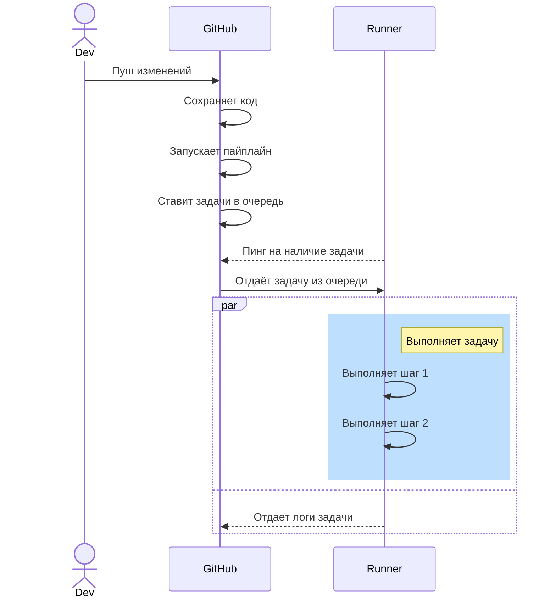
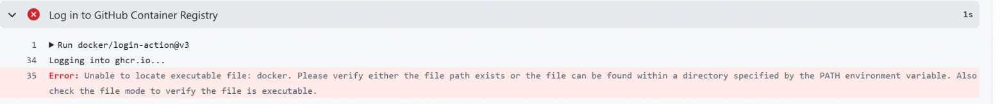
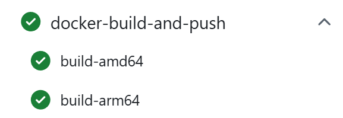
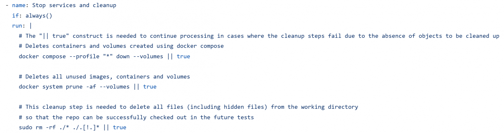

# GitHub self-hosted runner in Docker: how to set up multiple isolated runners on a single host. Part 1

Если у вас приватные репозитории на GitHub и команда, которая регулярно упирается в лимит времени GitHub Actions, эта статья сэкономит вам пару недель экспериментов.

Расскажем о том, что такое раннеры, как разворачивать self-hosted раннеры Bare Metal и в контейнере, как настраивать их репликацию с помощью Docker Compose, а также с какими трудностями мы столкнулись, пока искали решение наших проблем, и при чем тут Docker-in-Docker. Постарались рассказать подробно, чтобы было понятно даже самым маленьким.

Если интересно сразу посмотреть на результат, то весь исходный код и инструкцию по запуску можете найти [тут](https://github.com/TourmalineCore/github-self-hosted-runners-template).

## Навигация по статье
* [Background and description of the problem](#background-and-description-of-the-problem)
* [Basics: Who are runners, and where do they run?](#basics-who-are-runners-and-where-do-they-run)
  + [About multiplatform](#about-multiplatform)
  + [Our setup](#our-setup)
  + [Deploying a self-hosted Bare Metal runner](#deploying-a-self-hosted-bare-metal-runner)
* [Evolving from Bare Metal to a container](#evolving-from-bare-metal-to-a-container)
  + [Testing the Bare Metal runner](#testing-the-bare-metal-runner)
  + [Running runners in Docker](#running-runners-in-docker)
      - [Environment variables](#environment-variables)
      - [Building an image](#building-an-image)
      - [Setting up a configuration for Docker Compose](#setting-up-a-configuration-for-docker-compose)
      - [Script for running the runner](#script-for-running-the-runner)
  + [New challenges](#new-challenges)
  + [Building a DinD Runner](#building-a-dind-runner)
      - [Building an image](#building-an-image-1)
      - [Script for running the runner](#script-for-running-the-runner-1)
      - [Docker Compose configuration](#docker-compose-configuration)
  + [Results](#results)

## Предыстория и описание проблемы

Раньше мы использовали GitHub для open source проектов, а для приватной разработки GitLab. Но однажды не смогли регистрировать новые GitLab-аккаунты с российских номеров, из-за чего чаша весов склонилась в сторону GitHub и для приватной разработки тоже.

Над одним из приватных проектов на GitHub работала команда из 3 человек. Каждый день команда активно коммитила, и после каждого пуша в ветку запускались пайплайны. Их суммарное время выполнения было около 50 минут. GitHub выделяет [2,000 минут](https://docs.github.com/en/get-started/learning-about-github/githubs-plans#github-free-for-organizations) для организации каждый месяц на запуск пайплайнов на их раннерах для приватных репозиториев. Эти минуты команда израсходовала за первую рабочую неделю месяца. После того, как закончились выделенные минуты, нужно ждать следующего месяца, чтобы снова пользоваться GitHub-раннерами. Из-за того, что минуты закончились, у нас остановились процессы доставки фич в продакшен для всех команд GitHub-организации (у них общий лимит на все репозитории организации), поэтому это ограничение стало серьёзной проблемой.

Во времена, когда мы использовали GitLab для приватной разработки, мы пользовались self-managed GitLab-раннерами, которые позволяют запускать все пайплайны на наших серверах в офисе. У GitHub есть аналогичный инструмент, который называется GitHub [self-hosted runners](https://docs.github.com/en/actions/concepts/runners/self-hosted-runners), и он помог решить все наши проблемы.

Помимо нашей проблемы с лимитами минут, есть ещё такие примеры проблем, с которыми вам могут помочь self-hosted GitHub-раннеры:

* У вас есть устройство, которое нужно использовать в пайплайнах. Например, видеокарта, которая подключена к серверу в вашем офисе, а не в дата-центре GitHub.
* У вас есть закрытый ресурс, доступ к которому должен быть только с определённого IP-адреса, и этот ресурс используется в пайплайнах. Например, удалённый сервер, к которому можно подключиться только из вашего офиса.
* Ресурсы ЦП и ОЗУ, которые выделяются GitHub, могут быть недостаточны для ваших задач. Для приватных репозиториев это 2 ЦП и 8 ГБ ОЗУ. Подробнее [тут](https://docs.github.com/en/actions/reference/runners/github-hosted-runners#standard-github-hosted-runners-for--private-repositories).

## База: кто такие раннеры и куда они бегут

Задавались ли вы вопросом, как запускаются ваши пайплайны, после того как вы запушили новый коммит? Начинающих инженеров может одолевать страх, когда они слышат про какие-то раннеры. Не сразу понимаешь, что это за бегуны такие.
Ничего страшного в них на самом деле нет. Раннер — это Bare Metal сервер или виртуальная машина, на которую загружается и на которой выполняется ваш код CI/CD-пайплайна, описанный в .yaml-файлах в папке `.github`.



Изначально GitHub предоставляет свои собственные раннеры, где заранее установлено много [инструментов](https://github.com/actions/runner-images/blob/main/images/ubuntu/Ubuntu2404-Readme.md) для вашего удобства. Но существует много ситуаций, в которых вам может понадобиться второй тип раннеров — self-hosted. Self-hosted раннеры — это такие же раннеры, которые могут выполнять пайплайны, но теперь они будут запускаться на ваших серверах, использовать ресурсы ваших серверов и хранить данные во время запуска на ваших серверах, а не на серверах GitHub. Вы можете предустанавливать любые инструменты, подключать любые устройства, необходимые для проекта и выбирать конфигурацию оборудования.

### Про мультиплатформенность
У нас в компании все работают на разных устройствах, а эти устройства в свою очередь на разных архитектурах: amd64 и arm64. Поэтому нам важно собирать Docker-образ сразу под amd64 и arm64, а значит, нужно иметь 2 сервера на соответствующих архитектурах. Знающие люди скажут, что можно использовать эмулятор QEMU для того, чтобы собирать образ сразу под 2 платформы, используя при этом только 1 устройство. Однако при использовании QEMU значительно увеличивается время сборки образов, и по нашему сравнению, собирать на нативных раннерах получается намного быстрее. Подробнее про сравнение можно посмотреть в записи доклада по [ссылке с таймкодом](https://youtu.be/Xn8qtCbTffM?si=Xle8xI8XEX_igP4i&t=560).

Но если коротко, то замеры такие:

<table>
    <thead>
        <tr>
            <th>Сервис</th>
            <th>Было на QEMU</th>
            <th>Стало на нативных раннерах</th>
        </tr>
    </thead>
    <tbody>
        <tr>
            <td valign="top">Strapi CMS</td>
            <td valign="top">18 минут</td>
            <td valign="top">4 минуты</td>
        </tr>
        <tr>
            <td valign="top">NextJS UI</td>
            <td valign="top">13 минут</td>
            <td valign="top">2 минуты</td>
        </tr>
    </tbody>
</table>

У нас в офисе лежал без дела подходящий для нативной сборки ПК, поэтому мы решили его задействовать для этой работы.

### Наш сетап
Под сборку amd64 мы использовали сервер с процессором Ryzen Threadripper PRO 3975W и ОС Ubuntu Server 24.04.
Под сборку arm64 выбор поменьше, и мы выбрали уже имеющийся у нас Mac Mini с процессором Apple M2 и ОС macOS Tahoe.

<p align="center">
  
</p>

### Deploying a self-hosted Bare Metal runner
GitHub предоставляет [инструкции](https://docs.github.com/en/actions/how-tos/manage-runners/self-hosted-runners/add-runners), как разворачивать self-hosted раннеры.
Оказалось, что для создания раннера не нужно выполнять много действий, и всё поднимается в несколько команд. Для этого нужно выбрать ОС, архитектуру и выполнить команды для скачивания раннера.
<p align="center">
  
</p>

Далее привязываем раннер к организации и запускаем его.
<p align="center">
  
</p>

При запуске раннера через интерактивный диалог можно будет указать:
* Отдельную группу для раннера. Раннеры объединяют в группы для того, чтобы можно было контролировать, какие репозитории и пайплайны могут взаимодействовать с раннерами из этой группы.
* Имя, для того, чтобы найти его в списке раннеров. Может быть удобно, когда вы хотите разделять раннеры по конфигурации оборудования. Например, можно придумать naming convention и назвать раннер «self-hosted-amd64-4cpu-8ram», что будет означать amd64 архитектуру, 4 ядра процессора и 8 ГБ оперативной памяти.
* Метки, для того, чтобы указывать, на каком раннере или раннерах запускать пайплайн. Например, можно разделять раннеры по конфигурации оборудования:
```yaml
jobs:
  build-amd64:
    runs-on: [self-hosted, 4gb, 4cpu, amd64] # раннер, у которого 4 Гб ОЗУ, 4 ядра ЦП, архитектура amd64 
  build-arm64:
    runs-on: [self-hosted, gpu, arm64] # раннер, у которого есть видеокарта и архитектура arm64
```
Но мы оставим стандартную раннер-группу, потому что в рамках статьи у нас нет надобности управлять доступом к раннеру, а также поменяем имя и метку, чтобы отличать раннеры друг от друга и для сборки amd64-образа использовать именно amd64-раннер.
<p align="center">
  
</p>
Для arm64-раннера делается все аналогично.

>**Примечание**: все наши пайплайны написаны под Ubuntu. Например, мы используем команду:
>
>`echo "REGISTRY_IMAGE=ghcr.io/${GITHUB_REPOSITORY,,}" >>${GITHUB_ENV}`
>
>Эта команда не сможет выполниться на macOS и упадет с ошибкой «bad substitution». Если раннер на macOS попробует выполнить пайплайн, в котором используется эта команда, то пайплайн упадет. Для решения этой проблемы можно рассмотреть 2 пути:
>1. Переписать пайплайны под macOS.
>2. Запускать раннер как Docker-контейнер с базовым образом Ubuntu.
>
>Мы выбрали второй вариант и рассмотрим его позже.

## Эволюционируем из Bare Metal в контейнер

### Проверяем работу Bare Metal раннера
Для запуска пайплайнов на self-hosted раннерах нужно указать label нужного раннера в «runs-on». В нашем случае «self-hosted-amd64» для сборки amd64 образа.
<p align="center">
  
</p>

Переходим в Actions и наблюдаем результаты наших трудов…
<p align="center">
  
</p>

Установленные раннеры не содержат все те инструменты, которые уже предустановлены в [GitHub-раннерах](https://github.com/actions/runner-images/blob/main/images/ubuntu/Ubuntu2404-Readme.md), и поэтому нужно устанавливать все нужные инструменты на свое железо заранее.  
В нашем случае не хватает докера, поэтому установим его по [этой](https://docs.docker.com/engine/install/ubuntu) инструкции, дадим доступ non-root пользователю по [этой](https://docs.docker.com/engine/install/linux-postinstall/#manage-docker-as-a-non-root-user) инструкции и перезапустим пайплайн.
<p align="center">
  
</p>

Отлично, билд прошел, но что делать с тем случаем, когда нужно запускать много пайплайнов одновременно, но сервер только один?

Можно попробовать скопировать директорию текущего раннера много раз и запустить несколько реплик Bare Metal. Представим ситуацию, что вам нужно запустить 50 реплик одного раннера. В таком случае вам нужно будет скопировать раннер в 50 директорий и запустить каждую реплику вручную. А что, если отключится электричество? Тогда нужно будет снова запускать все 50 реплик вручную, что очень неудобно. Кто-то скажет, что можно написать скрипт, с помощью которого можно все это автоматизировать, но кому это надо… Еще один минус, с которым мы уже столкнулись, — это установка всех зависимостей перед запуском раннера. Если мы будем использовать несколько Bare Metal машин, то нам придется каждый раз устанавливать все зависимости. Также сохраняется проблема с тем, что мы не можем нативно собирать arm64-образ, используя Mac mini, из-за того, что пайплайны сборки образов написаны под Ubuntu. Если хотим запускать пайплайны, то придется переписывать их под macOS.

Мы пришли к тому, что можно запускать раннеры как отдельный Docker-контейнер, потому что тогда можно будет прописать все инструменты заранее в Dockerfile и легко воспроизводить раннер, а также создавать много реплик раннера через Docker Compose.

### Запускаем раннеры в Docker`е
К сожалению, у GitHub нет готового решения, как засунуть раннер в контейнер без использования Kubernetes (в отличие от GitLab, например). Изучая этот вопрос, на просторах интернета мы нашли [реализацию](https://github.com/Groupe-3D/self-hosted-runner), которая должна была нам помочь. В текущей реализации установлено много инструментов, которые не нужны для выполнения наших целей. Соберем минимальный образ на основе этого репозитория.

#### Переменные окружения
Первым делом нужно создать файл, в котором будут записаны все переменные. По классике назовем этот файл `.env`.

*.env*

`REPOSITORY_OWNER` — организация, в которую будет добавлен раннер.
`REG_TOKEN` — токен, с помощью которого раннер привяжется к организации. Токен живет 1 час, если нужно будет пересоздать контейнер, то нужно будет получить новый.
`RUNNER_GROUP` — группа раннеров, в которую будет добавлен раннер.
`LABELS` — метки, по которым можно будет обратиться к раннеру.

```
REPOSITORY_OWNER=TourmalineCore
REG_TOKEN=ATLGSK5MV5ACPPPTKVMEITJ5IHYY  
RUNNER_GROUP=Default  
LABELS=self-hosted-amd64
```

#### Собираем образ
*DockerImage/Dockerfile*
Теперь перейдем к сборке самого образа. Сначала указываем основу нашего образа. Берем такой же дистрибутив, на котором запускались пайплайны, когда использовали GitHub-раннеры.
```Dockerfile
FROM ubuntu:24.04
```
С помощью `update` получаем информацию по доступным для установки пакетам, через `upgrade` обновляем уже установленные пакеты и через `install` устанавливаем минимальный набор инструментов, необходимый для загрузки, настройки и запуска раннера.
```Dockerfile
RUN apt-get update -y && \
    apt-get upgrade -y && \
    apt-get install -y \
                curl \
                sudo \
                ca-certificates
```
curl (Client URL) — утилита командной строки и библиотека, предназначенная для передачи данных между компьютером и сервером по различным сетевым протоколам. Нужна в образе, чтобы скачать раннер.  
sudo (superuser do) — утилита, которая позволяет non-root пользователям выполнять команды с правами администратора. Используется в образе для того, чтобы настроить запуск раннера.  
ca-certificates — пакет, который содержит набор доверенных сертификатов центров сертификации. Нужен для того, чтобы разрешать TLS соединения. Используется в образе для того, чтобы установить Docker.

Для сборки образов нам нужен Docker, поэтому устанавливаем по [официальной инструкции](https://docs.docker.com/engine/install/ubuntu).  его. Для того, чтобы не указывать версию Docker в нескольких местах, вынесли её в аргумент. Важно: указывать нужно такую же версию, которая установлена на вашем сервере, или совместимую. Релизы Docker можно найти [тут](https://docs.docker.com/engine/release-notes).
```Dockerfile
ARG DOCKER_VERSION="28.5.2"

RUN install -m 0755 -d /etc/apt/keyrings && \
    curl -fsSL https://download.docker.com/linux/ubuntu/gpg -o /etc/apt/keyrings/docker.asc && \
    chmod a+r /etc/apt/keyrings/docker.asc && \
    # Add the repository to Apt sources:
    echo \
    "deb [arch=$(dpkg --print-architecture) signed-by=/etc/apt/keyrings/docker.asc] https://download.docker.com/linux/ubuntu \
    $(. /etc/os-release && echo "${UBUNTU_CODENAME:-$VERSION_CODENAME}") stable" | \
      tee /etc/apt/sources.list.d/docker.list > /dev/null && \
    apt-get update && \
    apt install -y --no-install-recommends \
                   containerd.io \
                   docker-buildx-plugin \
                   docker-ce-cli=5:${DOCKER_VERSION}-1~ubuntu.24.04~noble \
                   docker-compose-plugin && \
    rm -rf /var/lib/apt/lists/*
```
По умолчанию раннер падает с ошибкой «Must not run with sudo», если его запускать через `sudo`, поэтому нужно создать отдельного юзера. Например, с именем `runner`. Дополнительно добавляем созданного пользователя в группу `sudo` и делаем доступ без пароля, чтобы от этого пользователя работали команды через `sudo` — они понадобятся для настройки раннера в скрипте запуска далее.

```Dockerfile
RUN useradd -m runner && \
    usermod -aG sudo runner && \
    echo "%sudo   ALL=(ALL:ALL) NOPASSWD:ALL" > /etc/sudoers
```
Далее используем встроенный в Docker аргумент `TARGETARCH`, который содержит платформу, под которую собирается образ. Он нужен, чтобы автоматически выбирать раннер, основываясь на платформе нашего железа. Также выносим в аргумент версию раннера. Делается это для того, чтобы указывать версию только в одном месте, в случае, если нужно обновить раннер. Релизы раннеров можно найти [тут](https://github.com/actions/runner/releases). После загрузки раннера устанавливаем нужные ему зависимости. Далее копируем скрипт для запуска раннера (его покажем позже), и вызываем его.

```Dockerfile
ARG TARGETARCH
ARG RUNNER_VERSION="2.334.0"

# В нашем случае, использование аргумента TARGETARCH ориентировано на amd64 и arm64. Если вам нужны дополнительные архитектуры, то используйте case, а не if
RUN ARCH=$([ "$TARGETARCH" = "amd64" ] && echo x64 || echo arm64) && \
    cd /home/runner && \
    mkdir actions-runner && \
    cd actions-runner && \
    curl -o actions-runner-linux-${ARCH}-${RUNNER_VERSION}.tar.gz -L https://github.com/actions/runner/releases/download/v${RUNNER_VERSION}/actions-runner-linux-${ARCH}-${RUNNER_VERSION}.tar.gz && \
    tar xzf ./actions-runner-linux-${ARCH}-${RUNNER_VERSION}.tar.gz

# Устанавливаем зависимости, необходимые для запуска раннера 
RUN /home/runner/actions-runner/bin/installdependencies.sh

USER runner

# Копируем скрипт и делаем его выполняемым 
COPY start.sh /start.sh
RUN sudo chmod +x /start.sh

ENTRYPOINT ["/start.sh"]
```

#### Собираем конфиг для Docker Compose

Следующий шаг — это конфигурация для Docker Compose. Здесь описывается то, сколько будет реплик раннера, сколько ресурсов доступно одной реплике и прочая конфигурация.

*docker-compose.yml*
Указываем путь до Dockerfile.
```yaml
services:
  runner:
    build:
      dockerfile: Dockerfile
      context: ./DockerImage
```
Далее указываем, что раннер должен всегда перезапускаться сам, кроме случая, когда его выключили вручную. Пригодится, если он упал с ошибкой или если перезапустили сервер, на котором развернут раннер.  
Тут же указываем файл, из которого будут считываться переменные. В нашем случае это `.env`.
```yaml
    restart: unless-stopped
    env_file: .env
```

Для настройки количества реплик нужно включить режим `replicated` и указать количество реплик в `replicas`. Для настройки того, сколько ресурсов хостовой машины доступно одной реплике раннера, есть `limits` и `reservations`. В `limits` указывается, сколько ресурсов ЦП и ОЗУ планировщик ресурсов выделит раннеру максимально, а в `reservations` указывается, сколько ЦП и ОЗУ планировщик гарантированно выделит раннеру. Это не то значение, которое контейнер потребляет при старте, а то, которое планировщик резервирует для этого контейнера. Осознанный и грамотный выбор `reservations` и `limits` выходит за рамки этой статьи.

```yaml
    deploy:  
      mode: replicated  
      replicas: 2  
      resources:  
       limits:  
        cpus: '2'  
        memory: 2G  
       reservations:  
        cpus: '0.1'  
        memory: 256M
```

Далее, для того, чтобы в контейнере заработал Docker, нужно дать доступ к Docker`у, который установлен на хостовой машине. Для этого прокинем в контейнер сокет, с помощью которого происходит взаимодействие между Docker-клиентом и Docker-демоном.

```yaml
    volumes:
      - /var/run/docker.sock:/var/run/docker.sock
```

И, наконец, переходим к скрипту, который будет выполняться при запуске контейнера.

#### Скрипт для запуска раннера

В этом скрипте мы привязываем раннер к организации, настраиваем доступ к файлу `docker.sock`, чтобы раннер мог обращаться к докеру, обрабатываем удаление раннера из организации при его остановке и в самом конце запускаем настроенный раннер.

*DockerImage/start.sh*
Добавляем раннер в организацию.

```bash
#!/bin/bash

cd /home/runner/actions-runner || exit

./config.sh --url https://github.com/${REPOSITORY_OWNER} --token ${REG_TOKEN} --runnergroup $RUNNER_GROUP --labels $LABELS
```

Далее нужно настроить доступ к файлу `docker.sock`. Как было сказано ранее, мы используем 2 сервера: с ОС Ubuntu 24.04 и с macOS. В Unix-подобных системах у каждого файла есть пользователь, которому принадлежит этот файл, а также группа пользователей, которые могут читать или изменять файл в зависимости от настроек. У каждой группы есть свой идентификатор, по которому можно к ней обращаться.  
На хостовой машине с Ubuntu файл `docker.sock` принадлежит группе docker (обычно у группы docker идентификатор 988), а в контейнере группы docker нет, и если проверить, кому принадлежит файл, то он будет принадлежать числовому идентификатору хостовой группы (обычно 988). Для того, чтобы получить доступ, нужно в контейнере создать группу с этим идентификатором и добавить в эту группу пользователя `runner`.

Для macOS все немного иначе. Под капотом Docker для macOS устроен не так, как для linux-дистрибутивов. Тут не создаётся Docker-группа и `docker.sock` принадлежит группе daemon, а в контейнер сокет проксируется уже с группой root. Группа root в контейнере уже существует, поэтому мы сразу добавляем пользователя в эту группу.
```bash
# Получаем ID группы, которой принадлежит файл  
export DOCKER_GID=$(stat -c '%g' /var/run/docker.sock)

# Проверяем, существует ли группа*  
if getent group "${DOCKER_GID}" >/dev/null; then  
  # Сразу добавляем пользователя в группу, потому что она уже создана  
  export DOCKER_GNAME=$(stat -c '%G' /var/run/docker.sock)  
  sudo usermod -aG ${DOCKER_GNAME} runner    
else  
  # Создаем группу, если ее еще нет и добавляем в нее пользователя  
  sudo groupadd -g ${DOCKER_GID} docker  
  sudo usermod -aG docker runner  
fi
```
Обрабатываем удаление раннера из организации в случае, если контейнер был остановлен. Важное: удаление раннера будет работать в течение часа после создания токена, поэтому если попробуете остановить контейнер через месяц после создания, то раннер останется привязанным к организации. Но это не страшно, потому что GitHub автоматически удаляет раннеры, которые находятся в выключенном состоянии 14 дней.

```bash
cleanup() {  
  echo "Removing runner..."  
  ./config.sh remove --token ${REG_TOKEN}  
}

# Вызов метода cleanup, когда поступает сигнал TERM (при остановке контейнера)
trap 'cleanup' TERM 
```

В самом конце запускаем раннер и добавляем ожидание, пока процесс раннера не завершится. Сделано это из-за того, что скрипт запускается как entrypoint контейнера, поэтому после запуска скрипта контейнер завершает работу. Из-за того, что пользователя runner добавили в группу, которой принадлежит docker.sock в этом же скрипте, запущенный раннер не будет видеть это изменение. Запускаем раннер через новую сессию для пользователя runner, в которой будут все актуальные группы.

```bash
# Запускаем раннер и добавляем ожидание, пока процесс раннера не завершится. Сделано это для того, чтобы после выполнения скрипта контейнер продолжал жить и раннер работал.  
sudo -u runner bash -c ./run.sh & wait $!
```

Запускаем раннер командой `docker compose up --build` и видим, что теперь запускается несколько реплик одного раннера одновременно. Для запуска в фоне добавляем флаг `-d`. Флаг `--build` используем для того, чтобы всегда собирать новый образ, а не использовать ранее собранный.
```bash
docker compose up -d --build 
```

<p align="center">
  
</p>

Такой же командой запускаем arm64-раннер на соответствующем сервере.

Теперь можно запускать сборку amd64 + arm64 образа в пайплайнах и радоваться результату.

>Пример пайплайна со сборкой образа под amd64 и arm64 [тут](https://github.com/TourmalineCore/inner-circle-items-api/blob/master/.github/workflows/.reusable-docker-build-and-push.yml). Этот пайплайн запускается на раннерах GitHub, потому что это публичный репозиторий, а значит у него неограниченная квота на использование раннеров.

### Новые проблемы
В пайплайнах мы запускаем не только сборку Docker-образов, но и тесты. Например, для запуска верхнеуровневых E2E-тестов мы создаём k8s-кластер и тестируем сервисы, которые в нём разворачиваются. Если запускать один такой тест, то все хорошо. Но если параллельно запустить эти тесты на нескольких раннерах, то мы сталкиваемся с проблемой, что кластер с именем проекта уже создан, и нельзя создать ещё один.  
Почему это происходит?  
Дело в том, что при создании раннера мы монтировали Docker-сокет `/var/run/docker.sock:/var/run/docker.sock`. Такая реализация называется Docker-outside-of-Docker и означает, что все обращения к Docker в контейнере будут выноситься за его пределы и выполняться в Docker`е, который установлен на хостовой машине. А если этот Docker-сокет монтируется в каждый раннер, то у всех раннеров фактически один общий Docker и общие контейнеры. Решение оказалось на первый взгляд простым. Нужно запускать Docker в раннере,а не монтировать Docker сокет. Такой подход называется Docker-in-Docker (DinD).

### Собираем DinD раннер
По большей части, образ остается такой же. Почти все зависимости устанавливаются как и раньше.

#### Собираем образ
*Dockerfile*

При установке Docker добавляется пакет docker-ce. Он нужен для того, чтобы запускать Docker в самом контейнере, а не использовать тот Docker, который установлен на хосте.

```Dockerfile
…  
RUN …
    apt install -y --no-install-recommends \
                   docker-ce=5:${DOCKER_VERSION}-1~ubuntu.24.04~noble \
… 
```
>**Примечание**: начиная с 29 версии докера, поменялась конвенция именования релизов, из-за чего нужно будет отредактировать URL. Все релизы смотреть [тут](https://github.com/moby/moby/releases).
>**Примечание 2**: в статье не стали использовать последнюю версию Docker(29.5.2 на момент написания), потому что после перезапуска контейнера сталкивались с ошибкой «error unmounting container», с которой пока что не разобрались, но обязательно разберёмся.

Далее загружаем скрипт, который подготавливает контейнер к запуску в нём докера. Флаг `-f` добавили для того, чтобы шаг падал с ошибкой, в случае, если не удалось найти файл.
```Dockerfile
RUN curl -f "https://github.com/moby/moby/raw/v${DOCKER_VERSION}/hack/dind" -o /usr/local/bin/dind \
  && chmod a+x /usr/local/bin/dind
```

Как и раньше создаём пользователя и добавляем его в группу `sudo`, но теперь группа Docker создаётся при установке пакета `docker-ce`, поэтому её создавать не надо и можно добавлять пользователя сразу в Dockerfile.
```Dockerfile
RUN useradd -m runner && \
    usermod -aG sudo runner && \
    usermod -aG docker runner && \
    echo "%sudo   ALL=(ALL:ALL) NOPASSWD:ALL" > /etc/sudoers
```

Дальше всё как было раньше: загружаем раннер, а также копируем скрипт для запуска раннера.

Единственное изменение, которое нужно добавить до entrypoint: нужно добавить вольюм для директории `/var/lib/docker`. Это делается для того, чтобы использовать драйвер хранилища `overlay2`. В противном случае, будет использоваться более медленный `VFS`, из-за чего могут возникать ошибки при работе с контейнерами. Например, может не создаваться k8s-кластер, потому что согласно [документации](https://etcd.io/docs/v3.3/op-guide/hardware), для работы etcd (хранилище данных в Kubernetes) нужен быстрый накопитель.
```Dockerfile
VOLUME /var/lib/docker
```

#### Скрипт для запуска раннера
Скрипт, который выполняется при запуске контейнера, также претерпел некоторые изменения.
*DockerImage/start.sh*  
После перезапуска контейнера мы сталкивались с тем, что процесс Docker считается запущенным, из-за чего не запускался новый демон Docker, но при этом Docker на самом деле не работал. Также сталкивались с проблемой, что после перезапуска часть runtime-состояний Docker были битыми, если существовал какой-нибудь контейнер, из-за чего в логах контейнера были ошибки «failed to load shim».
Для решения этих проблем, мы удаляем файл `docker.pid`, который содержит в себе идентификатор запущенного процесса Docker до перезапуска, но при этом самого процесса уже нет. А также очищаем runtime директорию docker, где остались runtime-состояния контейнеров.
```bash
#!/bin/bash

cd /home/runner/actions-runner || exit

# Очистка Docker перед запуском 
sudo rm -f /var/run/docker.pid  
sudo rm -rf /var/run/docker 
```

Далее настраиваем раннер и запускаем Docker-демон:
```bash
./config.sh --url https://github.com/${REPOSITORY_OWNER} --token ${REG_TOKEN} --runnergroup $RUNNER_GROUP --labels $LABELS

# Запуск Docker-демона
sudo /usr/local/bin/dind dockerd --log-level=error &
```
Остальная часть скрипта осталась без изменений.

#### Конфиг для Docker Compose
*docker-compose.yml*  
Для запуска DinD-раннера, контейнер нужно запускать с повышенными правами. Для этого есть флаг `privileged`. Также теперь не нужно монтировать файл docker.sock, потому что Docker запускается в контейнере. В остальном, Docker Compose конфигурация не меняется.  
Privileged-контейнер — компромисс, который мы осознанно приняли: у нас приватные репозитории, ограниченный набор разработчиков, раннеры в офисной сети. Для публичных репозиториев или случая, когда workflow могут прилетать извне, это уже не вариант (как и Docker-outside-of-Docker с доступом к хосту). В этом случае нужно смотреть в сторону rootless DinD или Sysbox. Об этом напишем отдельную статью.
```yaml
services:
  runner:
    build:
      dockerfile: Dockerfile
      context: ./DockerImage
    restart: unless-stopped
    env_file: .env
    privileged: true
```

Запускается раннер, как и раньше, командой:
```bash
docker compose up -d –-build
```
После этого можем запускать несколько пайплайнов параллельно и радоваться результату.

### Results
У такого решения есть как плюсы, так и минусы. Основной задачей было возобновить работу команд в приватных репозиториях, с чем self-hosted раннеры справились отлично. Кроме того, преимуществом является то, что можно заранее установить и сконфигурировать нужные инструменты, любую конфигурацию оборудования, подключить и использовать внешние устройства, а также использовать раннеры столько, сколько нам нужно. Однако недостаток заключается в том, что при выполнении пайплайнов на диске сохраняется много данных, которые не удаляются после выполнения пайплайна. Из-за этого приходится добавлять шаг очистки после выполнения пайплайна. Пример:

<p align="center">
  
</p>

Помимо этого, если вы ограничены в ресурсах, то нужно потратить время на оценку того, сколько ЦП и ОЗУ потребляется при выполнении пайплайнов, чтобы правильно выставить лимиты.
Есть вид раннеров, которые создаются непосредственно перед выполнением пайплайна и удаляются сразу после выполнения, то есть не сохраняют никакое состояние. Такие раннеры называются **эфемерными**, но о них мы расскажем уже во второй части этой статьи.
Спасибо за прочтение! Если у вас есть идеи по улучшению или замечания по описанной конфигурации, то пишите о них в комментариях под этой статьей, будем рады услышать ваше мнение.

Авторы статьи: Максим Рычков, Мария Ядрышникова